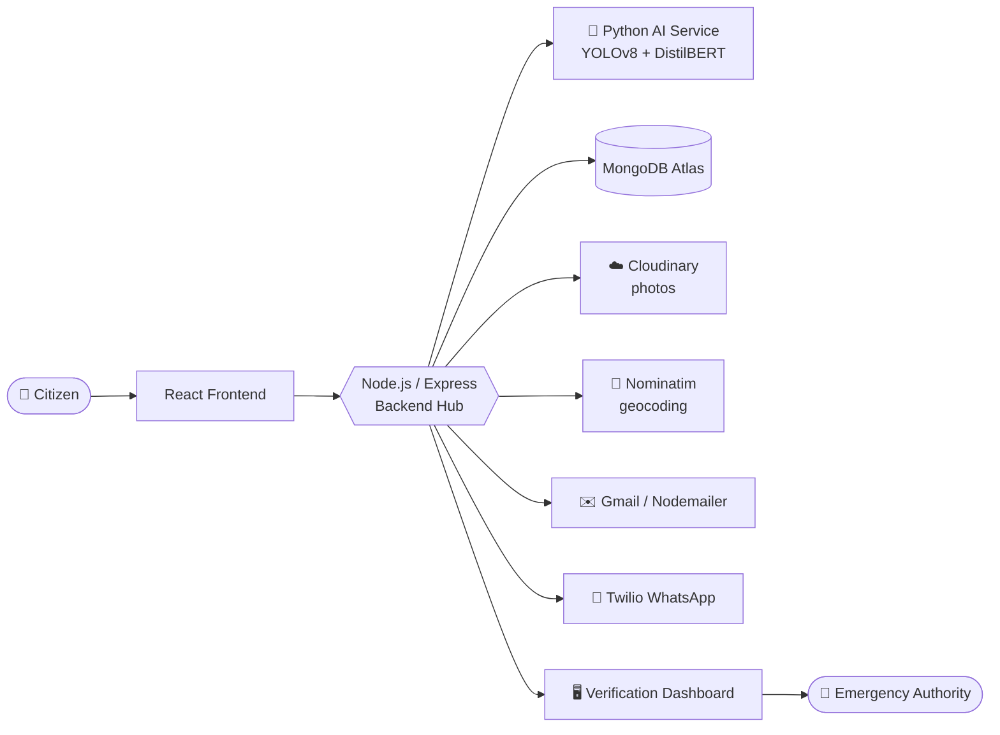
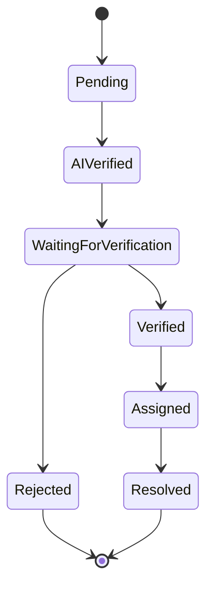

<div align="center">

# 🚨 Epicenter

### AI-Powered Disaster Verification & Emergency Response Platform

*Report an emergency in under a minute. Let AI pre-verify it. Get help moving faster.*


[Overview](#-overview) •
[Features](#-key-features) •
[Architecture](#-system-architecture) •
[AI Pipeline](#-how-ai-verification-works) •
[Setup](#-getting-started) •
[Team](#-team)

</div>

---

## 📖 Overview

When a disaster strikes, the gap between someone noticing it and the right authority acting on it is often too long: slow forms, manual checks, and no way to track progress.

**Epicenter** closes that gap. Citizens report an incident with a photo and a location in under 60 seconds, with or without an account. The platform analyses the report with two AI models, flags how severe and how trustworthy it looks, and hands it to a verification officer who confirms it and dispatches a response team. The citizen watches the status update live.

### ⏱️ Target Performance

| Stage | Target |
| :--- | :---: |
| Report submission | **< 60 sec** |
| AI verification | **< 1 min** |
| Team assignment | **2 – 3 min** |

---

## ✨ Key Features

| | Feature | Details |
| :-: | :--- | :--- |
| ⚡ | **Fast reporting** | Photo, location, optional description. Guest mode needs no account. |
| 🤖 | **Dual-signal AI verification** | Image detection plus text classification, combined into severity and a mismatch flag. |
| 🔍 | **Transparent AI output** | The dashboard shows category, confidence, severity, and which signal decided the category. |
| 🧭 | **Officer Command Center** | The most urgent incident first, with verify, reject, assign, and resolve actions. |
| 📡 | **Live status tracking** | Reported → AI Checked → Verified → Team Assigned, updating automatically. |
| 🧩 | **Duplicate merging** | Same incident type at the same location becomes one record. |
| 🔔 | **Notifications** | Status updates by email and WhatsApp. |
| 🛡️ | **Abuse protection** | Rate limiting on public routes. |

**Supported incident categories:** Fire · Flooding · Building Collapse · Gas / Chemical Leak · Road or Bridge Damage · People Trapped or Injured · Electrical Hazard · Fallen Tree or Pole

---

## 🏗️ System Architecture



The **backend is the hub**. The frontend talks only to the backend, and only the backend calls the AI service, the database, and the third-party services. The AI service never touches the database: it receives an image and text, runs inference, and returns JSON.

---

## 🧰 Tech Stack

<table>
<tr><td><b>Frontend</b></td><td>React (Vite) · Tailwind CSS · React Router · Axios</td></tr>
<tr><td><b>Backend</b></td><td>Node.js · Express.js · Multer</td></tr>
<tr><td><b>Database</b></td><td>MongoDB Atlas · Mongoose</td></tr>
<tr><td><b>AI service</b></td><td>Python · FastAPI</td></tr>
<tr><td><b>Image detection</b></td><td>YOLOv8 (Ultralytics), custom-trained on disaster categories</td></tr>
<tr><td><b>Text classification</b></td><td>DistilBERT zero-shot NLI (<code>typeform/distilbert-base-uncased-mnli</code>)</td></tr>
<tr><td><b>Auth</b></td><td>JWT · bcrypt · Google OAuth</td></tr>
<tr><td><b>Integrations</b></td><td>Cloudinary · Nominatim · Nodemailer (Gmail) · Twilio (WhatsApp) · Arcjet</td></tr>
</table>

---

## 🧠 How AI Verification Works

Every new report goes from the backend to the AI service, which runs two independent models.

**1. 🖼️ Image analysis (YOLOv8).** A custom model, fine-tuned on a Roboflow-labelled dataset, detects nine classes: `fire` · `flooding` · `building-collapse` · `gas-leak` · `electrical` · `fallen-tree` · `people-trapped` · `road-damage` · `smoke`.

**2. 📝 Text analysis (DistilBERT zero-shot).** The description is classified against the same categories, so loosely worded text like *"smell of gas near the shop"* still maps to the right one.

**3. ⚖️ Combining signals.**

- Final severity is the **higher** of the two signals.
- If the AI result **disagrees** with the category the citizen picked, a **mismatch flag** is raised so the officer looks closer.
- If the text model's confidence is below a fixed threshold, the **citizen's own selection** is used, and the dashboard records which source won along with both confidence values.

> AI output never auto-rejects a report. It points officer attention where it is needed most.

---

## 🔄 Incident Lifecycle



---

## 👥 User Roles

| Role | Access | What they do |
| :--- | :--- | :--- |
| **Citizen** | Guest, or Google sign-in | Report incidents, track status, view "My Reports" (when signed in), receive email or WhatsApp updates. |
| **Verification Officer** | Employee ID + password (accounts created directly in the database, no public signup) | Review AI findings, verify or reject, assign teams, resolve incidents. |

---

## 🗂️ Project Structure

```
epicenter/
├── frontend/      # React (Vite): citizen pages and officer dashboard
├── backend/       # Express API: auth, incidents, notifications, AI calls
└── ai-service/    # FastAPI: image detection and text classification
```

> Folder names may differ in your copy. Adjust the commands below to match.

---

## 🚀 Getting Started

### Prerequisites

- Node.js (LTS) and npm
- Python 3.10+ and pip
- A MongoDB Atlas cluster (or local MongoDB)
- Keys for Cloudinary, Twilio (WhatsApp), Google OAuth, and a Gmail app password

### Run locally

Start the services in this order: **AI service → backend → frontend**.

<details>
<summary><b>1️⃣ AI service</b></summary>

```bash
cd ai-service
python -m venv venv
source venv/bin/activate        # Windows: venv\Scripts\activate
pip install -r requirements.txt
uvicorn app:app --host 0.0.0.0 --port 8000
```

Make sure the trained model files are in this folder, otherwise the service fails when it loads them.

</details>

<details>
<summary><b>2️⃣ Backend</b></summary>

```bash
cd backend
npm install
# create a .env file (see below)
npm run dev        # or: npm start (check scripts in package.json)
```

</details>

<details>
<summary><b>3️⃣ Frontend</b></summary>

```bash
cd frontend
npm install
# create a .env file (see below)
npm run dev
```

Open the URL Vite prints, usually `http://localhost:5173`.

</details>

### 🔐 Environment variables

Create a `.env` in each folder. Names below are indicative; use the exact names your code reads. **Never commit real secrets.**

<details>
<summary><b>backend/.env</b></summary>

```env
PORT=5000
MONGODB_URI=<your MongoDB connection string>
JWT_SECRET=<a long random string>
AI_SERVICE_URL=http://localhost:8000

CLOUDINARY_CLOUD_NAME=<value>
CLOUDINARY_API_KEY=<value>
CLOUDINARY_API_SECRET=<value>

GOOGLE_CLIENT_ID=<value>

EMAIL_USER=<gmail address>
EMAIL_PASS=<gmail app password>

TWILIO_ACCOUNT_SID=<value>
TWILIO_AUTH_TOKEN=<value>
TWILIO_WHATSAPP_FROM=<value>

ARCJET_KEY=<value>
```

</details>

<details>
<summary><b>frontend/.env</b></summary>

```env
VITE_API_URL=http://localhost:5000
VITE_GOOGLE_CLIENT_ID=<value>
```

</details>

---

## 🔒 Security

- Passwords hashed with **bcrypt**, never stored in plain text
- Stateless **JWT** auth; officer routes check both the token and the officer role
- **Arcjet** rate limiting on public submission and login routes
- Secrets kept in environment variables, out of source control

---


---


---

<div align="center">

⭐ If you found this project useful, consider giving it a star.

</div>
